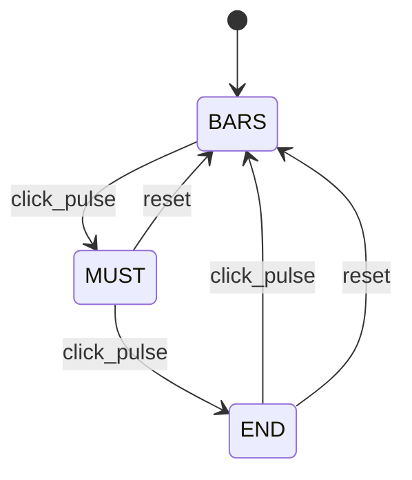

# Lab 4：VGA 三画面状态机仿真工程

> **GitHub 整理版说明（2026-11-10）**：以 `Lab4_VGA_Simulation(1).zip` 的 RTL 设计、testbench、脚本和约束文件为基础。仅在 `lab4_top.v` 与 `key_debounce.v` 中保留 `Lab4_VGA_Board_Compatible(1).zip` 的标准 Verilog 模块声明写法，以便 Simple VGA Simulator 识别顶层。其余五个 RTL 文件与第一份完全相同。已删除旧 `build/` 缓存和重复包装目录；生成的输出会在本机运行脚本时重新产生。此整理版未在当前环境重新运行 Icarus/Yosys，使用前请执行下方命令确认。

按 EIE330 Lab 4 要求整理的独立工程。顶层是 `lab4_top`，无需 Lab 3 源码。**本工程未使用你原来的 Lab 3 模块**；如果课程要求复用你自己的模块，请在理解接口后替换相应显示模块。

## 1. 先运行

需要 Python 3、Icarus Verilog（`iverilog` 和 `vvp`）；综合另外需要 Yosys。Python 脚本仅使用标准库。所有命令均在本文件所在目录执行。

```text
python3 scripts/run.py
```

Windows 可将 `python3` 换成 `python`。仿真失败时脚本返回非零退出码；全部通过后生成 `build/results.json`。运行日志、VCD 波形、画面 PNG 均保存在各自的 `build/tb_*/` 文件夹。

运行仿真和通用综合检查：

```text
python3 scripts/run.py --synth
```

只运行一组测试：

```text
python3 scripts/run.py --test tb_lab4_top
python3 scripts/run.py --test tb_key_real_time
```

工具不在 PATH 时，使用 `--iverilog 路径 --vvp 路径 --yosys 路径`，或者设置 `IVERILOG`、`VVP`、`YOSYS` 环境变量。**工具程序不包含在本压缩包中**。

## 2. 文件结构

```text
RTL/
  lab4_top.v             顶层，接口与实验要求一致
  clock_reset.v          50 MHz 二分频；复位异步置位、同步释放
  key_debounce.v         两级输入同步、计数消抖、单次按下脉冲
  screen_controller.v    Moore 状态机、垂直消隐期提交画面
  vga_timing.v           800×525 扫描计数、负极性同步、有效区
  font_rom.v             M/U/S/T/E/N/D 的 5×7 点阵
  pixel_generator.v      彩条和居中文字，RGB565 输出
sim/
  tb_*.v                 7 个自检测试台（关键时序测试带超时保护）
  waves.gtkw             顶层波形信号列表
  run_modelsim.do        ModelSim/Questa 备用运行脚本（未在本机执行）
scripts/
  run.py                 编译、运行、检查 PASS、PPM 转 PNG、可选综合
  vcd2csv.py             按时间窗口导出 VCD 为 CSV
constraints/
  lab4.sdc               时钟约束示例，需按实际 FPGA 工具修改
build/                   仿真运行后自动生成（不上传 GitHub）
VERIFICATION.md          验证范围、测试映射和限制
```

ModelSim/Questa：在工程根目录执行 `do sim/run_modelsim.do`。RTL 和测试台均按 SystemVerilog 兼容模式读取（Icarus 使用 `-g2012`；RTL 主要采用 Verilog 写法，计数常量有显式宽度转换）。

## 3. 顶层与设计参数

| 端口 | 方向 | 说明 |
|---|---|---|
| `sys_clk` | 输入 | 50 MHz |
| `sys_rst_n` | 输入 | 低有效，异步复位 |
| `key_in` | 输入 | 低有效切屏按键 |
| `hsync` | 输出 | 负极性行同步 |
| `vsync` | 输出 | 负极性场同步 |
| `rgb[15:0]` | 输出 | RGB565：R[15:11]、G[10:5]、B[4:0] |

状态编码：`0=BARS`、`1=MUST`、`2=END`。每次有效按下按 `0 → 1 → 2 → 0` 循环；释放不触发切换。任意状态复位回 `0`。



数据流：`sys_clk → clock_reset → pixel_clk`；`key_in → 两级同步 → 计数消抖 → click_pulse → 状态机`；`扫描坐标 + 已提交状态 → pixel_generator → rgb`。

- 工作像素时钟：25 MHz（50 MHz 二分频），周期 40 ns。
- 行时序：有效 640、前肩 16、同步 96、后肩 48，共 800 点。
- 场时序：有效 480、前肩 10、同步 2、后肩 33，共 525 行。
- 行周期 32 µs，帧周期 16.8 ms，帧率 **59.5238 Hz**，属于本工程采用的近似 60 Hz 时序；不是精确 25.175 MHz 的 59.94 Hz。真实显示器兼容性需另行验证。
- 生产参数 `DEBOUNCE_CYCLES=500000`：25,000,000 × 0.020 = 500,000 个周期，即 20 ms；计数器宽度 19 位，末值 499999。
- 电平变化连续稳定满 500000 次采样才被接受；中途回到原电平，计数清零。同步输入额外带来约两个像素周期延迟。
- 复位后按键初始为“未授权再次按下”。必须先稳定释放 20 ms 才会重新响应，因此复位期间一直按住按键不会产生幽灵点击。
- `requested_state` 在按下事件后变化；`screen_state` 在 `x=0,y=480` 进入垂直消隐区时提交。正常切屏延迟不超过一帧。复位直接回彩条，为保持立即复位语义，复位不等待帧边界。
- 同一边界到达的点击会被本次提交采纳；多个未显示请求按模三累计。在生产参数下，相邻有效点击还需要稳定释放与再次按下，共至少约 40 ms，长于一帧。

## 4. 精确画面定义

坐标从有效显示区左上角 `(0,0)` 开始，范围 x=0..639、y=0..479。

彩条：8 条，各宽 80，覆盖全部 480 行。按从左至右顺序为：

| x 范围（含两端） | 颜色 | RGB565 |
|---|---|---|
| 0..79 | 红 | F800 |
| 80..159 | 黄 | FFE0 |
| 160..239 | 绿 | 07E0 |
| 240..319 | 青 | 07FF |
| 320..399 | 蓝 | 001F |
| 400..479 | 品红 | F81F |
| 480..559 | 白 | FFFF |
| 560..639 | 黑 | 0000 |

文字：5×7 点阵放大 8 倍，每字 40×56 像素，字间 8 像素。黑底 `0000`、白字 `FFFF`，整个词组居中。字框纵坐标均为 y=212..267。

| 屏幕 | 字符 | x 范围（含两端） |
|---|---|---|
| MUST | M / U / S / T | 228..267 / 276..315 / 324..363 / 372..411 |
| END | E / N / D | 252..291 / 300..339 / 348..387 |

ROM 每一行 bit4 是最左边像素、bit0 是最右边；第 0 行在最上方。字符框中位图为 0 的位置也输出黑色。无效显示区一律输出黑色。完整画面由 **RTL 仿真输出**生成：

GitHub 精简版不包含 `build/` 生成文件。运行 `python3 scripts/run.py` 后，可在 Ubuntu 中查看实际仿真输出：

```bash
xdg-open build/tb_pixel_generator/bars.png
xdg-open build/tb_pixel_generator/must.png
xdg-open build/tb_pixel_generator/end.png
```

## 5. 测试与波形

`tb_lab4_top` 和快速按键单元测试使用 **8 周期加速消抖**，保留真实 50/25 MHz 时钟和完整 VGA 帧时序。`tb_key_real_time` 单独使用 **真实 500000 周期/20 ms**，不能把加速测试的几百纳秒当成板上消抖时间。

每个测试台均包含 `$dumpfile` 和 `$dumpvars`。为了控制文件大小，真实消抖测试及 VGA 时序测试使用 `$dumpoff/$dumpon` 只记录关键窗口；暂停记录时 VCD 中的 x 代表没有记录该区间，不表示 RTL 故障。

GTKWave 打开 `build/tb_lab4_top/lab4_top.vcd`；可加载 `sim/waves.gtkw`。查看真实消抖末值时打开 `build/tb_key_real_time/key_real_time.vcd`，重点观察约 48 ms 附近的 `dut.stable_count`、`key_level` 与 `click_pulse`。

导出该窗口：

```text
python3 scripts/vcd2csv.py build/tb_key_real_time/key_real_time.vcd -o build/debounce_window.csv --start-ns 47999720 --end-ns 48000800 --signals tb_key_real_time.dut.stable_count tb_key_real_time.key_level tb_key_real_time.click_pulse
```

CSV 中向量保持二进制字符串，可据此另行绘图；时间单位统一为 ns。实验报告中的波形图需从数据绘制，不应直接使用 GTKWave 截图。

## 6. 综合和上板范围

脚本的 Yosys 检查使用 `synth -noabc`：完成通用综合、检查和资源统计，输出 `build/rtl.json`、`rtl.il`、`synth.json`、`yosys.log`。`rtl.json` 是 process 转换优化后的 RTL 网表，可导入兼容网表查看器；本包未附生成的 RTL 视图截图。

源工程测试环境的 Yosys ABC 辅助程序缺少运行库，因此采用上述明确跳过 ABC 技术映射的方式。日志中最终结果对应 `-noabc`。这不能证明目标 FPGA 器件的资源占用、时序收敛或物理实现正确。

未指定 FPGA 型号和板卡引脚，因此没有虚构 `.qsf` 引脚表。`lab4.sdc` 的生成时钟对象只是示例，需按实际综合网表修改；实体 FPGA 还应使用专用时钟资源/PLL，补齐时序约束并完成静态时序分析。未进行板级验证、录屏或报告编写。请按课程 AI 使用规范披露代码辅助生成，并自行理解、修改和验证。
